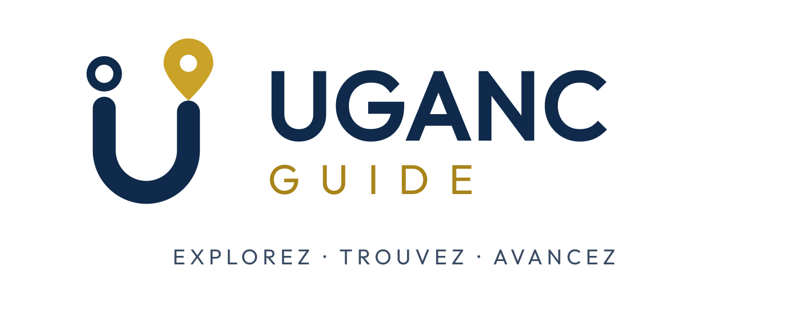

  

<strong>Explorez · Trouvez · Avancez</strong>

**UGANC GUIDE** est une plateforme web qui permet à chacun de trouver un lieu de l'Université Gamal Abdel Nasser de Conakry, de savoir ce qu'on y trouve et de s'y rendre à pied. Elle s'adresse aux nouveaux étudiants, aux étudiants actuels et aux visiteurs.

Le projet est porté par une équipe de 12 étudiants de l'UGANC.

## Les dépôts

| Dépôt                                                        | Contenu                                                      |
| ------------------------------------------------------------ | ------------------------------------------------------------ |
| [uganc-guide-web](https://github.com/uganc-guide-team/uganc-guide-web) | Frontend Next.js : carte, recherche, fiches des lieux, administration |
| [uganc-guide-api](https://github.com/uganc-guide-team/uganc-guide-api) | Backend NestJS : API REST, permissions, accès aux données    |
| [uganc-guide-data](https://github.com/uganc-guide-team/uganc-guide-data) | Données du campus : formulaire de collecte, couches GeoJSON, QGIS |
| [uganc-guide-docs](https://github.com/uganc-guide-team/uganc-guide-docs) | Cahier des charges, guides, charte graphique, comptes rendus |

## Technologies

Next.js · NestJS · Prisma · PostgreSQL + PostGIS · Supabase · Leaflet · OpenStreetMap · KoboToolbox · QGIS
